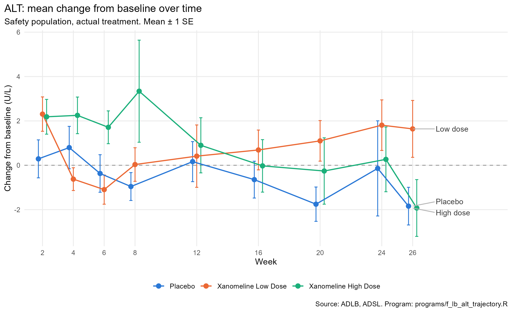
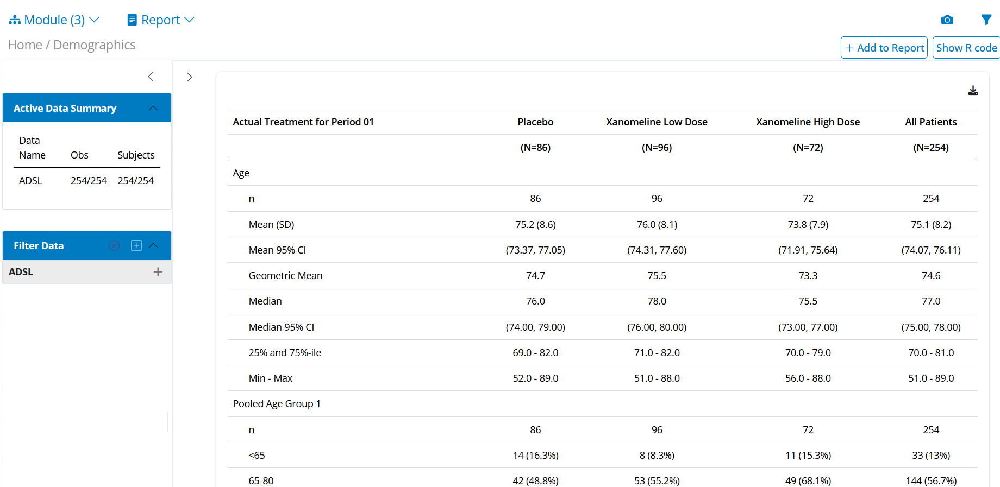
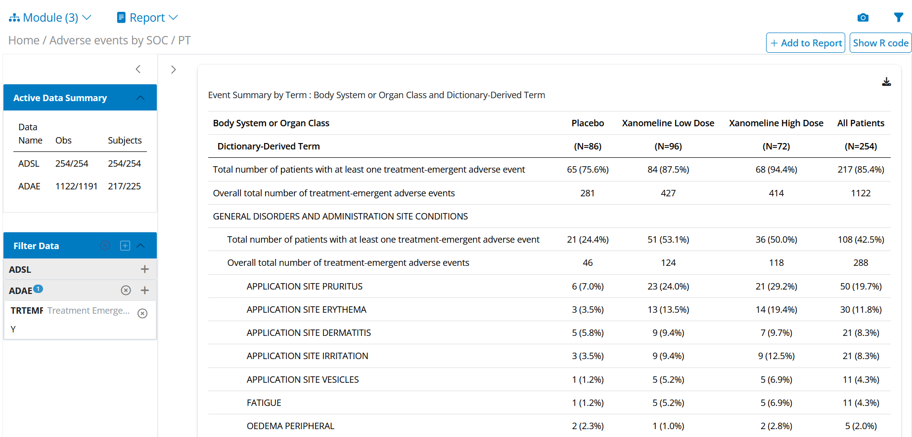
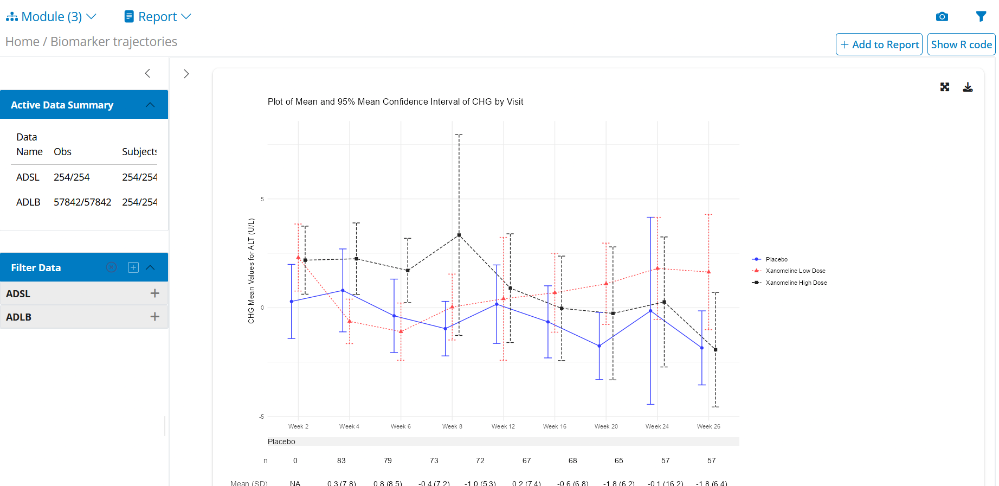

# Early-Phase Clinical Reporting Pipeline

[](https://github.com/SaraGhs/early-phase-clinical-reporting/actions/workflows/tests.yaml)

End-to-end, spec-driven clinical reporting in R: SDTM to validated ADaM datasets
(ADSL, ADAE, ADLB), SAS transport export, independent QC, safety tables and
figures, and an interactive teal app, built on the public CDISC pilot study.

> **Data:** public example SDTM data from the CDISC pilot study (`CDISCPILOT01`,
> xanomeline transdermal patch vs placebo) via the R package `pharmaversesdtm`.
> No real or confidential patient data is used. See [data/README.md](data/README.md).

## Results at a glance

| Area | Result |
|---|---|
| ADSL | 306 subjects; 254 in safety population (Placebo 86, Low Dose 96, High Dose 72) |
| ADAE | 1,191 records; 1,122 treatment-emergent; 217/254 subjects (85%) with ≥1 TEAE |
| ADLB | 59,580 records, 47 parameters; baseline derived for all 254 treated subjects |
| Metadata | 62 variables specified; xportr: no unresolved spec mismatches; XPT v5 exported |
| Double programming | diffdf: **zero unresolved discrepancies** (ADSL, ADAE) |
| SAS cross-check | PROC COMPARE: **all 306 subjects equal** |
| Automated tests | **47 testthat checks**, run in GitHub Actions on every push |

## Pipeline

1. **Explore SDTM** - [programs/00_explore.R](programs/00_explore.R)
2. **Write the metadata spec** - [specs/adam_spec.csv](specs/adam_spec.csv)
3. **Derive ADaM with admiral** - [adsl.R](programs/adsl.R), [adae.R](programs/adae.R), [adlb.R](programs/adlb.R)
4. **Apply spec and export XPT v5 with xportr** - [export_xpt.R](programs/export_xpt.R), [log](outputs/datasets/xportr_log.txt)
5. **Independent QC** - [qc/](qc/) (base R + diffdf, SAS PROC COMPARE), [QC log](qc/qc_log.md)
6. **Automated tests** - [tests/testthat/](tests/testthat/), [workflow](.github/workflows/tests.yaml)
7. **Tables and figures with rtables/tern and ggplot2/plotly** - [outputs/tlf/](outputs/tlf/)
8. **Interactive teal app** - [app/app.R](app/app.R)
9. **Report** - [report.qmd](report.qmd) / [report.html](report.html)

## Key derivation decisions

- **Baseline** = last non-missing value on or before first dose. The visit labelled
  BASELINE held only 12 lab records; 91% of baselines come from screening and 9%
  from unscheduled pre-dose re-tests.
- **Treatment-emergent AE** = start on or after first dose and within 30 days of
  last dose. All 69 non-TEAEs reconcile: 65 before first dose, 4 after the window.
- **Partial AE start dates** are imputed to the earliest possible date, never
  before first dose, with an imputation flag (`ASTDTF`).
- **Planned vs actual treatment**: 12 subjects randomized to High Dose received
  Low Dose; safety outputs use actual treatment (`TRT01A`).

Data issues found and how they were handled: [specs/data_issues.md](specs/data_issues.md).

## QC approach

- **Double programming:** key ADSL and ADAE variables re-derived in base R from
  the spec text (no admiral or dplyr), compared with `diffdf`.
- **Cross-language check:** ADSL re-derived in SAS (SAS OnDemand for Academics)
  and compared with the R output using PROC COMPARE.
- **Regression tests:** testthat checks for spec compliance, population
  definitions, the TEAE window, baseline selection and change-from-baseline
  formulas, verified to fail when a derivation is deliberately broken.
- **CI:** GitHub Actions restores locked package versions from `renv.lock` on a
  clean Linux machine and runs the tests on every push.

## Outputs

| Output | File |
|---|---|
| Table 14.1.1 Demographics | [t_demog.txt](outputs/tlf/t_demog.txt) |
| Table 14.3.1 TEAEs by SOC and PT | [t_ae_soc_pt.txt](outputs/tlf/t_ae_soc_pt.txt) |
| Table 14.3.4 ALT change from baseline | [t_lb_chg_alt.txt](outputs/tlf/t_lb_chg_alt.txt) |
| Figure 14.3.4 ALT trajectory | [PNG](outputs/tlf/f_lb_alt_trajectory.png) / [interactive HTML](outputs/tlf/f_lb_alt_trajectory.html) |



## Interactive app (teal)

Demographics, TEAEs by SOC/PT and lab trajectories for all 47 parameters, with
filters linked across ADSL, ADAE and ADLB and a "Show R code" button for
reproducibility.





## How to run

Requires R 4.4+ and RStudio. From the project root:

```r
renv::restore()                      # install locked package versions

source("programs/adsl.R")            # ADaM datasets
source("programs/adae.R")
source("programs/adlb.R")
source("programs/export_xpt.R")      # spec checks + XPT v5

source("qc/qc_adsl.R")               # independent QC (diffdf)
source("qc/qc_adae.R")
testthat::test_dir("tests/testthat") # automated tests

source("programs/t_demog.R")         # tables and figure
source("programs/t_ae_soc_pt.R")
source("programs/t_lb_chg_alt.R")
source("programs/f_lb_alt_trajectory.R")

shiny::runApp("app")                 # teal app
quarto::quarto_render("report.qmd")  # report
```

The SAS QC program is in [qc/sas/qc_adsl.sas](qc/sas/qc_adsl.sas) (run in SAS
OnDemand for Academics; inputs `dm.xpt`, `ex.xpt`, `adsl.xpt`).

## Repository structure

```
programs/            ADaM derivations, XPT export, tables and figures
specs/               ADaM metadata spec, data issues log
outputs/datasets/    ADaM datasets (.rds, .xpt) and xportr log
outputs/tlf/         tables (.txt) and figure (.png, .html)
qc/                  independent QC programs, diffdf logs, QC log, SAS QC
tests/testthat/      automated tests
app/                 teal app and screenshots
data/                data source documentation
.github/workflows/   CI workflow
```

## Notes and limitations

- Double programming was done by the same programmer, independently from the
  spec and with a different toolset; in a study team a second programmer would QC.
- Imputation rules and windows follow common conventions; a real study would
  follow its statistical analysis plan.
- When launching the app, teal notes that automatic session lockfiles need the
  `mirai` package; project reproducibility is handled by `renv.lock`.

## Author

Sara Gharouni Saffar, M.Sc. Biology - Computational and Quantitative Focus (McMaster University)
