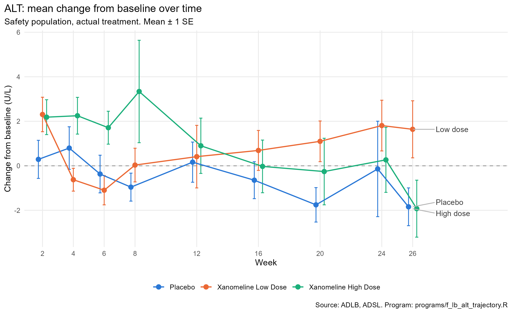

```{r}
library(dplyr)
adsl <- readRDS("outputs/datasets/adsl.rds")
adae <- readRDS("outputs/datasets/adae.rds")
adlb <- readRDS("outputs/datasets/adlb.rds")
```

## Purpose

This report summarises a spec-driven pipeline that derives ADSL, ADAE and ADLB
from SDTM data of the public CDISC pilot study, validates them independently,
and produces early-phase safety outputs. All data is public example data.

## Populations

```{r}
adsl |>
  mutate(TRT01A = factor(coalesce(TRT01A, "Not treated"),
                         levels = c("Placebo", "Xanomeline Low Dose",
                                    "Xanomeline High Dose", "Not treated"))) |>
  count(`Population` = if_else(SAFFL == "Y", "Safety (dosed)", "Screen failure"),
        `Actual treatment` = TRT01A) |>
  knitr::kable()
```

## Demographics

```{r}
#| comment: ""
cat(readLines("outputs/tlf/t_demog.txt"), sep = "\n")
```

## Treatment-emergent adverse events

```{r}
#| comment: ""
cat(readLines("outputs/tlf/t_ae_soc_pt.txt"), sep = "\n")
```

## ALT: change from baseline

```{r}
#| comment: ""
cat(readLines("outputs/tlf/t_lb_chg_alt.txt"), sep = "\n")
```



## Quality control



## Data issues


